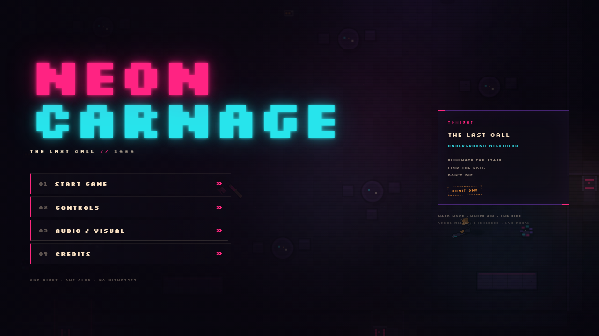
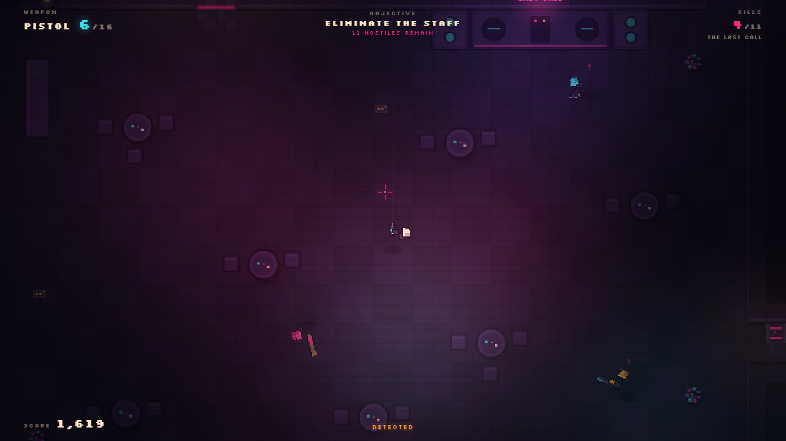
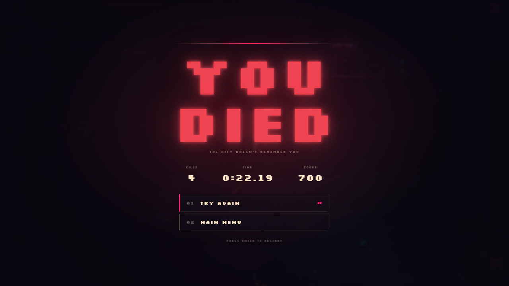

# NEON CARNAGE

**THE LAST CALL** — a one-level, top-down neon action game. Clear an underground
nightclub, take out the staff, and get out before the city notices. One hit kills
— yours included.

Vanilla **HTML5 + CSS + JavaScript**, Canvas 2D, **no framework, no build step,
no backend, and no runtime dependencies**. Every sprite is generated
procedurally at boot; every sound is synthesised with WebAudio.

**Play the live build:** <https://neon-carnage-da8.pages.dev/>





---

## Play locally

ES modules cannot be loaded from `file://`, so use any static file server.

```sh
# Node 18+ — bundled zero-dependency server
node tools/serve.mjs 8080

# or Python
python -m http.server 8080
```

Open <http://127.0.0.1:8080/>. The game itself needs no install, build or network
access; the server only exists to satisfy browser ES-module rules.

---

## Controls

| Input | Action |
|---|---|
| `WASD` / arrow keys | Move |
| Mouse | Aim |
| Left mouse | Shoot / attack with the equipped weapon |
| `Space` | Melee |
| `E` | Interact: open doors, pick up weapons and ammo, escape |
| `R` | Reload |
| `Q` / mouse wheel | Switch between gun and melee |
| `Esc` | Pause / resume |
| `Enter` | Restart from death or victory; start from the main menu |
| `M` | Mute / unmute |

Pistol and shotgun are semi-automatic; the SMG fires continuously while the
button is held. Audio begins after the first click or key press, as required by
browser autoplay rules. The game is fully playable with sound off.

---

## Objective

You start in the entrance of **The Last Call** with a pistol, eight rounds and
your fists. There are **11 hostiles** across the bar, main floor, VIP lounge,
backroom and storage.

- Eliminate every hostile. The exit stays sealed until the club is clear.
- Once the last enemy drops, the exit unlocks. Reach the exit pad in the
  bottom-right corridor to finish the level.
- Death is permanent for the run. `Enter` or **TRY AGAIN** rebuilds the level
  instantly; deaths in the current session are counted on the final score.
- Five doors block movement and sight. `E` opens them; enemies open doors
  themselves when chasing or investigating.

### Weapons

| Weapon | Magazine | Notes |
|---|---|---|
| Fists | — | Silent, short reach, permanent fallback |
| Bat | — | Longer reach, louder, replaces fists |
| Pistol | 8 | Accurate semi-auto, 16 spare rounds |
| SMG | 30 | Full-auto, wide spread, 30 spare rounds |
| Shotgun | 5 | Seven pellets, brutal at close range, slow reload |

Enemies drop their guns; dropped weapons keep the ammo they had left. Ammo
pickups only work if you are carrying the matching weapon.

### Enemies

| Archetype | Behaviour |
|---|---|
| **Thug** (pink) | Fast melee rusher. Telegraphs a lunge before striking. |
| **Goon** (cyan) | Pistol guard. Keeps distance and fires three-round bursts. |
| **Heavy** (orange) | Shotgun guard. Slow, tough pressure at close range. |

Enemies perceive through a view cone and tile line-of-sight, hear gunshots,
melee, doors and footsteps, shout to nearby allies, and navigate the level with
a breadth-first search. Closed doors block sight but can be opened by enemies.

---

## Scoring & grades

- Each kill is worth its archetype value (100 / 120 / 160).
- Consecutive kills inside a **4-second** window build a combo up to **×8**.
- Time bonus starts at 900 and drops by 8 per second.
- Accuracy adds up to 800 points.
- Each death this session costs 250 points.

| Grade | Minimum score |
|---|---|
| **S** | 4,200 |
| **A** | 3,200 |
| **B** | 2,300 |
| **C** | 1,500 |
| **D** | 0 |

The victory screen reports kills, time, accuracy, deaths and final score. Grades
S–D each get their own colour treatment.



---

## Audio / visual settings

Open **AUDIO / VISUAL** from the menu or pause screen:

- Music and SFX volume
- Master mute
- Screen shake
- Blood (also removes blood decals and particles)
- CRT scanlines

Settings persist in `localStorage` under `neon-carnage.settings.v1`. If storage
is unavailable, the game falls back to defaults without failing.

---

## Project layout

```
index.html                 Single-page shell: canvas + DOM HUD/menus
css/style.css              Palette tokens, HUD, screens, CRT overlay
js/
  main.js                  Boot, font wait, RAF loop, fatal-error surface
  config.js                Palette, weapons, enemies, scoring, key map
  core/                    Game state, input, camera, math helpers
  world/                   Tilemap, runtime level, level data
  render/                  Renderer, procedural sprites, particles, lighting
  entities/                Player, enemies, pickups, doors
  systems/                 Hitscan combat, synthesised audio, run stats
  ui/ui.js                 Screen routing, HUD updates, settings
assets/fonts/              Silkscreen (SIL Open Font License 1.1)
docs/ARCHITECTURE.md       Technical architecture
docs/screenshots/          Screenshots used in this README
ART_BIBLE.md               Visual rules, palette and sprite construction
tools/serve.mjs            Zero-dependency local static server
```

The full technical write-up is in [`docs/ARCHITECTURE.md`](docs/ARCHITECTURE.md).
Visual rules and the palette are in [`ART_BIBLE.md`](ART_BIBLE.md).

### Rendering and assets

- Fixed **640×360** internal render target, integer-scaled with nearest-neighbour
  sampling and letterboxed. The render is crisp at 2×, 3× and 4×.
- Static level geometry is baked once; lighting is a screen-space darkness mask
  with pre-rendered radial falloff. No `shadowBlur` in the gameplay loop.
- **No image or audio files are loaded at runtime.** Characters, weapons, props,
  tiles, blood, glows and UI art are generated procedurally. The only bundled
  binary is the Silkscreen font used by the DOM HUD and canvas signage.

---

## Development

### Local server

`tools/serve.mjs` serves the repository root, sets correct MIME types for ES
modules and falls back to `index.html`. It has no dependencies.

```sh
node tools/serve.mjs 8080
```

### Debug hooks

- `?autostart` or `#autostart` — skip the menu and enter the level immediately.
- `window.NEON_CARNAGE` — the live `Game` instance (state, player, enemies,
  renderer). Useful for manual smoke tests from the DevTools console. This is a
  development convenience, not a stable public API.

Example for poking at the running game:

```js
const g = window.NEON_CARNAGE;
g.player.x = 21 * 16;
g.player.y = 24 * 16;
g.camera.snapTo(g.player.x, g.player.y);
```

### Syntax checks

There is no compiler. Every module can be checked directly with Node:

```sh
node --check js/main.js
```

Repeat for the other files under `js/` if you change them. Serve the page and
watch the browser console; uncaught errors are also surfaced in-game by a fatal
error overlay.

---

## Deployment

The game is a plain static site. Deploy the repository root; there is no build
command, output directory rewrite or server-side code.

### Cloudflare Pages

**Option A — Git integration (recommended)**

1. Push this repository to GitHub.
2. In the Cloudflare dashboard, go to **Workers & Pages → Create → Pages →
   Connect to Git** and select the repository.
3. Use these settings:
   - **Framework preset:** None
   - **Build command:** leave empty
   - **Build output directory:** `/`
4. Deploy. Cloudflare serves `index.html` and the `js/`, `css/` and `assets/`
   folders directly.

**Option B — direct upload**

```sh
npx wrangler pages deploy . --project-name neon-carnage
```

Authenticate with `npx wrangler login` first. Upload the repository root, not a
build folder. Direct upload is a snapshot: after changing the game, run the
command again to redeploy. Use the Git integration option instead if you want
Cloudflare to redeploy automatically on every push.

### Any other static host

Upload the repository root to GitHub Pages, Netlify, Vercel, S3, nginx or any
static file server. Make sure `.js` files are served as `text/javascript` (or
`application/javascript`) so ES modules load.

---

## Testing status

Verified in Chromium (Microsoft Edge 156) on Windows at 1280×720 and 1920×1080,
using both interactive play and scripted frame stepping:

- Movement, wall/prop collision, camera follow and clamping
- Mouse aiming, hitscan, shotgun pellets, melee arcs, recoil and hit-stop
- All five weapons: firing, semi/full-auto behaviour, reload, empty mag,
  weapon swap/drop, ammo pickup and matching-weapon rules
- Doors: player interaction, enemy auto-open, sight/movement blocking
- All three enemy archetypes: patrol, perception, hearing, alert propagation,
  chase, attack, door use, death and weapon drops
- Death, restart, pause/resume, return to menu, victory and exit sealing
- Combo scoring, time/accuracy/death adjustments, grade thresholds and results
  screens
- Settings persistence, mute, blood toggle, scanline toggle and screen shake
- Level connectivity and spawn/exit paths for all 11 enemies
- All JavaScript modules pass `node --check`

Not covered: Firefox, Safari, mobile/touch input, gamepads, and low-end hardware
performance. There is no touch control scheme — the game is designed for
keyboard and mouse.

---

## Credits & license

- **Design, code, level, procedural art and synthesised audio:** original work
  created for this project. No stock imagery, recordings or third-party game
  assets are used.
- **Typeface:** [Silkscreen](https://github.com/kottke/silkscreen) by Jason
  Kottke, SIL Open Font License 1.1. The license text is bundled at
  [`assets/fonts/OFL.txt`](assets/fonts/OFL.txt).
- **Code:** MIT — see [`LICENSE`](LICENSE).

*If you hear a heartbeat, it's yours.*
